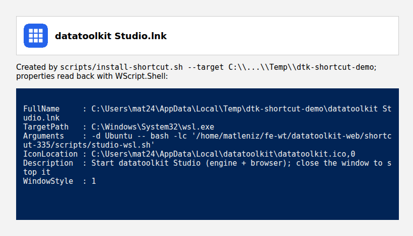
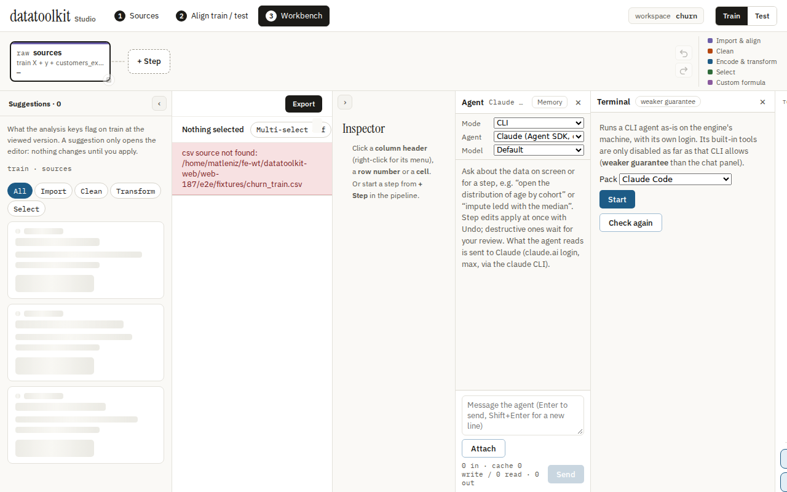

# Desktop shortcut

What `scripts/studio-shortcut.ps1`, `install-shortcut.sh` and `studio-wsl.sh` do.
Back to [Running Studio](running.md#desktop-shortcut).

## Windows (no WSL)

`studio-shortcut.ps1` writes `datatoolkit Studio.lnk` on the Desktop, found with
`[Environment]::GetFolderPath('Desktop')` (so `OneDrive\Bureau` works; paths with
spaces are fine). The icon is copied to `%LOCALAPPDATA%\datatoolkit`. A double
click runs `datatoolkit.ps1 -Uv` (the [uv launcher](running.md#run-without-docker-uv))
in a console window; closing it stops the process.
Options: `-Target <dir>`, `-Icon <path|url>`, `-Print` (the spec as JSON, creates
nothing).

## WSL (Studio and engine in `~/datatoolkit-web`, `~/datatoolkit`)

Run `scripts/install-shortcut.sh [--target DIR] [--print]` from the checkout. The
shortcut runs `wsl.exe -d <distro> --exec bash -l <path>/studio-wsl.sh`. `--exec`
skips wsl.exe's own shell, so the script path is one properly quoted argument
(spaces, apostrophes ok); single quotes would not be quoting for wsl.exe.

`studio-wsl.sh` builds Studio when `dist/` is stale, then runs `dtk-studio` with
the local engine (`DTK_ENGINE_DIR`, default `~/datatoolkit`; else the engine the
launcher pins) under `systemd-run --user --scope -p MemoryMax=3G`.

- **Cap:** `DTK_MEM_MAX` changes it. If `systemd-run --user` does not work, the
  script says so, waits for Enter and exits: it never starts uncapped by itself.
  `DTK_MEM_MAX=none` is the explicit opt-out.
- **Agent:** on. Chat panel with the `agent-sdk` pack (your own `claude` login,
  nothing stored), terminal packs with `DTK_AGENT_TERMINAL=1` (Claude Code,
  opencode, Gemini when installed). A `DTK_UI_TOKEN` is generated at each launch,
  in the process environment only. See [agent.md](agent.md).
- **Browser:** opened through `wslview`, else `explorer.exe`.

## Linux

`install-shortcut.sh` writes `datatoolkit-studio.desktop` (terminal, same
`studio-wsl.sh`) to the Desktop and `~/.local/share/applications`.

Tests: `tests/studioShortcut.test.ts`.
